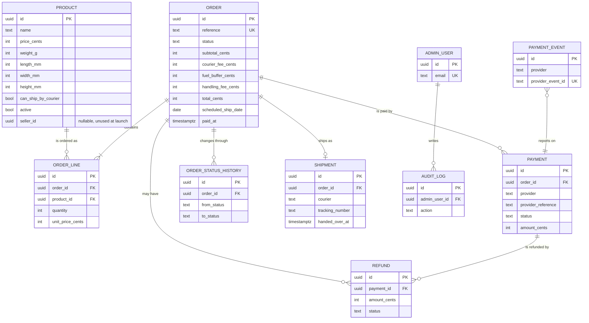

# Aisleway: Data Model

**Status:** Draft v0.1. Database: PostgreSQL 16. Access: SQLAlchemy 2.x. Migrations: Alembic.

This is the blueprint for the first migrations and for the repository tests. Rules referenced as `BR-xx` are in `business-rules.md`.

## Conventions

- **Primary keys:** `uuid` (generated by the app), except small lookup tables.
- **Money:** `integer` cents. Column names end in `_cents`.
- **Time:** `timestamptz`, stored in UTC, displayed in `Africa/Johannesburg`.
- **Dates:** `date` for scheduled ship and delivery dates (local SAST dates).
- **Statuses:** `text` with a `CHECK` constraint listing the allowed values.
- **Soft rules in the domain, hard safety in the database:** rules that change often (for example the R100 minimum) live in the domain core. Rules that must always hold (totals add up, no negative money, valid statuses) are also enforced with `CHECK` constraints.
- **Personal data:** only what BR-60 allows. Nothing about cards or bank accounts.

## Entity relationship diagram

---

## Tables

### `products`

| Column | Type | Null | Notes |
|---|---|---|---|
| id | uuid | no | PK |
| slug | text | no | unique, used in URLs |
| name | text | no | |
| description | text | yes | |
| price_cents | integer | no | `CHECK (price_cents >= 0)` |
| weight_g | integer | no | `CHECK (weight_g > 0)` |
| length_mm | integer | no | packed size, `CHECK (length_mm > 0)` |
| width_mm | integer | no | `CHECK (width_mm > 0)` |
| height_mm | integer | no | `CHECK (height_mm > 0)` |
| can_ship_by_courier | boolean | no | default `false` (BR-05, BR-51) |
| active | boolean | no | default `true` |
| seller_id | uuid | yes | unused at launch (BR-52) |
| created_at / updated_at | timestamptz | no | |

**Indexes:** unique `slug`; index on `(active)`.

### `orders`

Customer details are stored **on the order** (guest checkout, BR-06). There is no customers table at launch.

| Column | Type | Null | Notes |
|---|---|---|---|
| id | uuid | no | PK |
| reference | text | no | unique, human-friendly (for example `AW-2026-000123`), shown to customers |
| status | text | no | see status list below |
| customer_name | text | no | |
| customer_email | text | no | |
| customer_phone | text | no | |
| ship_address_line1 | text | no | |
| ship_address_line2 | text | yes | |
| ship_suburb | text | yes | |
| ship_city | text | no | |
| ship_province | text | no | |
| ship_postal_code | text | no | |
| subtotal_cents | integer | no | `CHECK (subtotal_cents >= 0)` |
| courier_fee_cents | integer | no | `CHECK (courier_fee_cents >= 0)` |
| fuel_buffer_cents | integer | no | `CHECK (fuel_buffer_cents >= 0)` |
| handling_fee_cents | integer | no | `CHECK (handling_fee_cents >= 0)` |
| total_cents | integer | no | `CHECK (total_cents = subtotal_cents + courier_fee_cents + fuel_buffer_cents + handling_fee_cents)` |
| parcel_size | text | no | size label chosen (for example `small`) |
| total_weight_g | integer | no | includes packaging (BR-14) |
| scheduled_ship_date | date | yes | set when paid (BR-34) |
| estimated_delivery_from / estimated_delivery_to | date | yes | BR-33 |
| paid_at | timestamptz | yes | basis for the cut-off (BR-31) |
| packed_at / shipped_at / delivered_at | timestamptz | yes | |
| cancelled_at | timestamptz | yes | |
| cancel_reason | text | yes | |
| packing_photo_ref | text | yes | BR-45 |
| created_at / updated_at | timestamptz | no | |

**Status values (`CHECK`):** `pending_payment`, `payment_failed`, `expired`, `paid`, `packed`, `shipped`, `delivered`, `cancelled`, `claim_open`, `replaced`, `refund_pending`, `refunded`.

**Indexes:** unique `reference`; `(status, scheduled_ship_date)` for the weekly pack list; `(customer_email)` for support lookups; `(created_at)`.

### `order_lines`

| Column | Type | Null | Notes |
|---|---|---|---|
| id | uuid | no | PK |
| order_id | uuid | no | FK to `orders`, `ON DELETE CASCADE` |
| product_id | uuid | no | FK to `products`, `ON DELETE RESTRICT` |
| product_name | text | no | copied at order time |
| quantity | integer | no | `CHECK (quantity >= 1)` (BR-04) |
| unit_price_cents | integer | no | copied at order time (BR-08) |
| unit_weight_g | integer | no | copied at order time |

**Index:** `(order_id)`.

### `payments`

| Column | Type | Null | Notes |
|---|---|---|---|
| id | uuid | no | PK |
| order_id | uuid | no | FK to `orders` |
| provider | text | no | for example the card or EFT provider name |
| method | text | yes | `card` or `instant_eft` |
| provider_reference | text | yes | provider's payment id |
| status | text | no | `pending`, `succeeded`, `failed`, `refunded`, `partially_refunded` |
| amount_cents | integer | no | `CHECK (amount_cents > 0)` |
| created_at / updated_at | timestamptz | no | |

**Indexes:** `(order_id)`; unique `(provider, provider_reference)` where reference is not null.

### `payment_events` (idempotency log)

Stores every provider notification we have processed, so a replayed event does nothing (BR-23).

| Column | Type | Null | Notes |
|---|---|---|---|
| id | uuid | no | PK |
| provider | text | no | |
| provider_event_id | text | no | |
| payment_id | uuid | yes | FK to `payments` |
| signature_valid | boolean | no | |
| outcome | text | no | `applied`, `ignored_duplicate`, `rejected_invalid`, `amount_mismatch` |
| received_at | timestamptz | no | |

**Constraint:** unique `(provider, provider_event_id)`.

Do **not** store raw payloads containing personal data. Keep only what is needed to investigate a dispute.

### `refunds`

| Column | Type | Null | Notes |
|---|---|---|---|
| id | uuid | no | PK |
| payment_id | uuid | no | FK to `payments` |
| order_id | uuid | no | FK to `orders` |
| amount_cents | integer | no | `CHECK (amount_cents > 0)` |
| reason | text | no | |
| status | text | no | `pending`, `completed`, `failed` |
| provider_reference | text | yes | |
| created_by | uuid | no | FK to `admin_users` |
| created_at | timestamptz | no | |

Application rule: the sum of refunds for a payment never exceeds the payment amount.

### `shipments`

| Column | Type | Null | Notes |
|---|---|---|---|
| id | uuid | no | PK |
| order_id | uuid | no | FK to `orders`, unique at launch (one parcel per order) |
| courier | text | no | |
| drop_off_mode | text | no | `locker_to_door` or `kiosk_to_door` |
| tracking_number | text | yes | entered by the owner at launch |
| handed_over_at | timestamptz | yes | |
| delivered_at | timestamptz | yes | |

### `order_status_history`

An append-only record of every status change.

| Column | Type | Null | Notes |
|---|---|---|---|
| id | uuid | no | PK |
| order_id | uuid | no | FK to `orders` |
| from_status | text | yes | null for the first entry |
| to_status | text | no | |
| actor | text | no | `system`, `customer`, `webhook` or an admin user id |
| note | text | yes | |
| created_at | timestamptz | no | |

**Index:** `(order_id, created_at)`.

### `admin_users`

| Column | Type | Null | Notes |
|---|---|---|---|
| id | uuid | no | PK |
| email | text | no | unique |
| password_hash | text | no | Argon2 |
| totp_secret | text | yes | encrypted, for two-step login |
| active | boolean | no | |
| last_login_at | timestamptz | yes | |

### `audit_log`

An append-only record of sensitive admin actions (BR-44).

| Column | Type | Null | Notes |
|---|---|---|---|
| id | uuid | no | PK |
| admin_user_id | uuid | yes | FK to `admin_users` |
| action | text | no | for example `order.mark_shipped`, `refund.create` |
| entity_type / entity_id | text / uuid | no | |
| details | jsonb | yes | no secrets or card data |
| created_at | timestamptz | no | |

---

## Order state transitions

The domain core enforces these. A database trigger is **not** used. Tests prove the rules.

| From | To | Trigger | Guard |
|---|---|---|---|
| (new) | `pending_payment` | Checkout submitted | Minimum order met, all products shippable (BR-01, BR-05) |
| `pending_payment` | `paid` | Verified payment event | Signature valid, exact amount, correct reference (BR-22) |
| `pending_payment` | `payment_failed` | Provider reports failure | |
| `payment_failed` | `pending_payment` | Customer retries | Order not expired |
| `pending_payment` | `expired` | Timer | Past `PAYMENT_EXPIRY_MINUTES` (BR-24) |
| `paid` | `packed` | Admin marks packed | |
| `packed` | `shipped` | Admin enters tracking and hands over | Tracking number present |
| `paid` / `packed` | `cancelled` | Customer request or admin | Not yet shipped (BR-40) |
| `cancelled` | `refund_pending` | Refund started | Paid order only |
| `shipped` | `delivered` | Admin or courier confirms | |
| `shipped` | `claim_open` | Lost or damaged | BR-43 |
| `claim_open` | `replaced` | Replacement sent | |
| `claim_open` | `refund_pending` | Refund chosen | |
| `refund_pending` | `refunded` | Refund confirmed | Refund total does not exceed payment |

Any other transition raises `InvalidTransition`.

---

## Constraints and integrity checklist

- [ ] `total_cents` equals the sum of its parts (`CHECK`).
- [ ] No negative money anywhere (`CHECK`).
- [ ] `quantity >= 1` (`CHECK`).
- [ ] Status columns limited to allowed values (`CHECK`).
- [ ] Order lines keep copied price, name and weight so history never changes.
- [ ] `payment_events` unique on `(provider, provider_event_id)` for replay protection.
- [ ] Foreign keys everywhere, and `ON DELETE RESTRICT` for anything with financial meaning.
- [ ] Append-only tables (`order_status_history`, `audit_log`, `payment_events`) are never updated or deleted by the app.

## Security and privacy notes

- Personal data lives mainly in `orders` (name, email, phone, address). Limit access and log admin reads of orders (BR-44, BR-62).
- Plan for a **data request** routine: export one customer's orders by email, and delete or anonymise personal fields while keeping the financial record the law requires.
- Encrypt secrets such as `totp_secret`. Never store card or bank data.
- Take automated, encrypted backups, and test restoring them.
- Use separate database users: the app user cannot drop tables, and a migration user runs Alembic.

## Marketplace readiness (later)

- `products.seller_id` exists but is unused.
- Later additions: `sellers`, `seller_payouts`, `commissions`, and a `seller_id` on `order_lines`.
- Splitting an order across sellers may mean **one shipment per seller** instead of one per order. The `shipments` table is a separate table for this reason, so the launch-time unique constraint on `order_id` can be removed in a later migration without redesigning anything.

## Migration plan

1. `0001_products`
2. `0002_orders_and_lines`
3. `0003_payments_and_events`
4. `0004_shipments_and_history`
5. `0005_refunds`
6. `0006_admin_users_and_audit_log`

Each migration is written after the repository tests that need it, in line with the test-first approach. Every migration must work forward and, where practical, backward, and be backwards compatible with the previous app version.

## Open questions

- [ ] Do we need stock quantities at launch, or is every product always available? If tracked, add `stock_quantity` to products and a reservation rule for pending orders.
- [ ] How long do we retain orders and personal data?
- [ ] Do we store the packing photo ourselves, or only a reference to a file store?
- [ ] Customer accounts later: how do we link existing guest orders by email?
